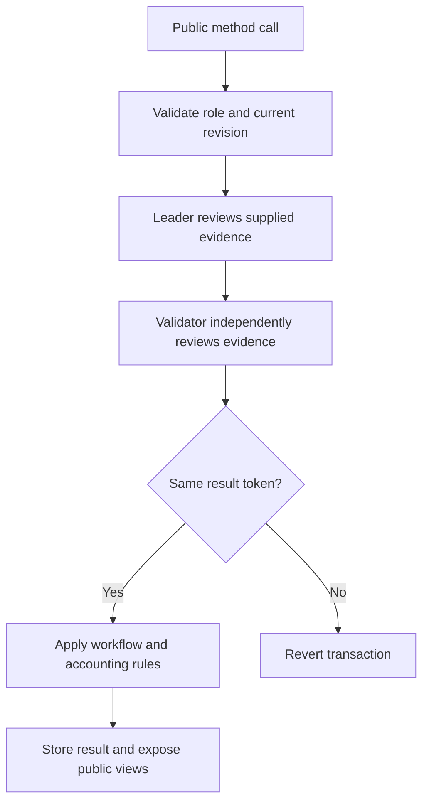

# From evidence to a released record

In DependencyExit, compatibility review records a candidate as ready, incompatible, uncertain, or in need of an adapter. The last result leads to a second review against the same requirements and candidate documentation. The record owner can select a candidate only when those gates pass.

BuildOrigin uses semantic consensus to evaluate whether each submitted build record matches the declared recipe and environment. After that, a deterministic comparison of the qualifying artifact hashes produces the final reproduced or contested result.

SchemaHandshake separates roles. A consumer wallet proposes its expectations. The provider can accept that offer only against the reviewed schema revision. A subsequent provider revision makes the old agreement historical while preserving its original schema text.
